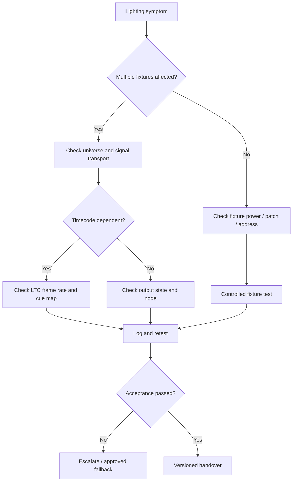

# Case Study — GrandMA3, DMX and LTC show continuity
**Status:** author-reported experience + reproducible design example; no employer show file or independently verified repair claim.

## Context
The author reports operating grandMA3 onPC aboard Ambassador *Ambience* in 2026, with approximately eight universes and 85 fixtures (figures awaiting authorized inventory verification). Earlier RWS/Marella experience included fixture faults, flicker and timecode troubleshooting.

## Reproducible diagnostic protocol
1. Record fixture IDs, universe, symptom, time and show state; freeze show-file version.
2. Compare console output, node, network transport and physical DMX link; isolate one segment at a time.
3. Verify fixture patch, address, mode and power independently from timecode.
4. Compare LTC source frame rate and cue/executor mapping against the approved show cue sheet.
5. Rehearse fallback with LTC disconnected in a **test environment**; do not experiment during a live performance.
6. Record expected/observed output, rollback, approval and retest.

## Synthetic cue map
| Cue | LTC (HH:MM:SS:FF) | Executor | Expected state | Fallback |
|---|---|---|---|---|
| DEMO-01 | 00:00:05:00 | 201 | Pre-show look | Manual GO |
| DEMO-02 | 00:00:18:12 | 202 | Transition | Manual GO |
| DEMO-03 | 00:00:41:00 | 203 | Finale | Manual GO |

The cue times are invented demonstration data, not a reconstruction of a proprietary production.

## Evidence required
Redacted contract or credit; authorized fixture inventory; approved photos; redacted fault log; rehearsal acceptance sheet. **No outcome or numerical performance improvement is claimed.**

## Transfer to management
The protocol provides a standard fault taxonomy, consistent handover and objective acceptance criteria for technical operations across multiple venues.
